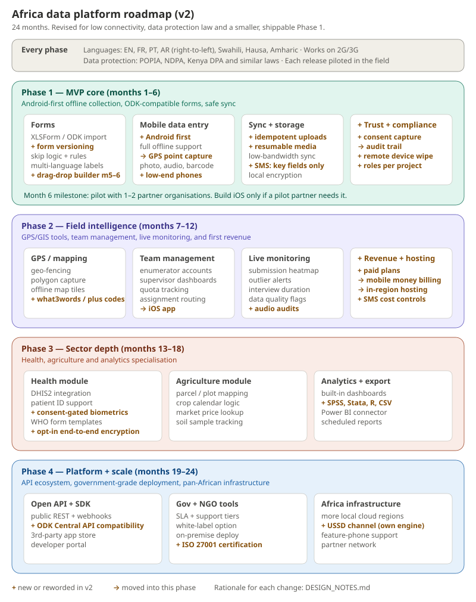

# Africa-focused data collection platform

An offline-first platform for collecting field data in low-connectivity areas across Africa. It serves NGOs, governments and researchers in health, agriculture and other sectors.

**Status:** design stage. No code yet.

## Current design (step 3)

- [System architecture](docs/03-revised-design/mvp_system_architecture_v2.svg)
- [Offline sync flow](docs/03-revised-design/offline_sync_flow_v2.svg)
- [Design notes and open decisions](docs/03-revised-design/DESIGN_NOTES.md)

## How the design evolved

Each step has its own folder, and each step is a separate commit in the git history.

| Step | Folder | What happened |
|---|---|---|
| 1 | [docs/01-initial-design](docs/01-initial-design/) | First roadmap, architecture and sync flow |
| 2 | [docs/02-design-review](docs/02-design-review/DESIGN_REVIEW.md) | Consistency review: 10 issues found |
| 3 | [docs/03-revised-design](docs/03-revised-design/) | Revised diagrams fixing those issues |

## Roadmap at a glance

| Phase | Months | Focus |
|---|---|---|
| 1. MVP core | 1–6 | Android-first offline app, XLSForm/ODK-compatible forms, safe sync, consent and audit trail; pilot at month 6 |
| 2. Field intelligence | 7–12 | Maps and GIS, team management, live monitoring, iOS, mobile money billing, in-region hosting |
| 3. Sector depth | 13–18 | Health (DHIS2), agriculture, analytics and export |
| 4. Platform and scale | 19–24 | Public API and SDK, on-premise and white-label, USSD, more local regions |

## Next steps

1. Settle the open decisions in [DESIGN_NOTES.md](docs/03-revised-design/DESIGN_NOTES.md#open-decisions-need-your-input).
2. Write the Phase 1 technical spec: data model, API contracts, sync protocol.
3. Start the Phase 1 code (`apps/` and `services/` folders to be added).
