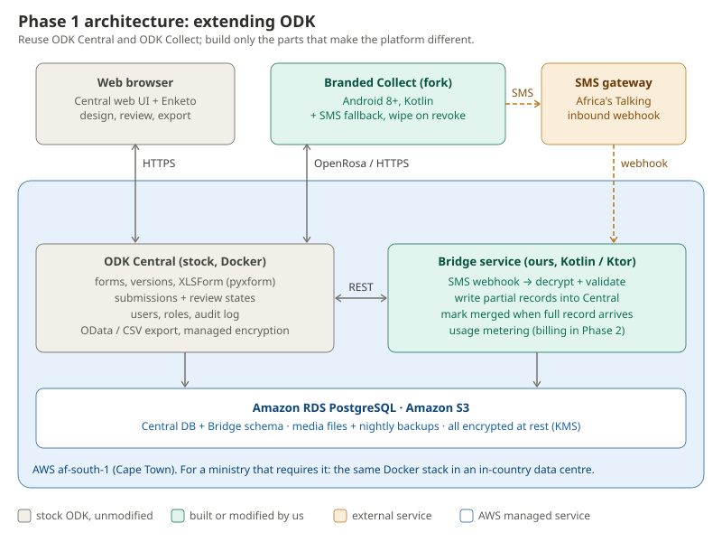

# Step 4: Phase 1 technical spec (months 1–6)

**Status:** draft, 9 November 2026  
**Readers:** the two developers building Phase 1, and the project lead



## 1. Decisions this spec is built on

| Decision | Choice | Consequence |
|---|---|---|
| Users | NGOs, researchers **and** ministries | Pilot with an NGO or research team first (faster to start); design hosting so a ministry can run it in-country later. |
| Team | 2 developers | Build as little as possible. Reuse ODK for everything that already works. |
| Mobile | Kotlin | Also use Kotlin for the backend service, so both devs share one language and the SMS codec is written once. |
| Hosting | AWS | Region **af-south-1 (Cape Town)**. |
| Approach | Extend ODK | Run stock ODK Central; fork ODK Collect only where needed. |

## 2. What we reuse vs. what we build

### Reuse as-is (no code)

| Need from the v2 design | Provided by |
|---|---|
| Forms, XLSForm import, form versions | ODK Central + pyxform |
| Offline data entry, skip logic, constraints, multi-language | ODK Collect |
| GPS point, photo, audio, video, barcode/QR, signature | ODK Collect |
| No duplicate submissions | Central rejects a second submission with the same `instanceID` |
| Users, project roles, audit log | ODK Central |
| Data review (approve / has issues / reject), CSV export, OData for Power BI / R | ODK Central |
| Web forms for desk staff | Enketo (bundled with Central) |
| Opt-in end-to-end encryption | Central "managed encryption" per project (the server can't read data without the passphrase) |
| Consent capture | An XLSForm consent template: a required first question that ends the form if refused (`forms/templates/consent.xlsx`) |

### Build (our code)

| Component | What | Owner |
|---|---|---|
| **Branded Collect fork** | Our name and branding; SMS fallback; wipe data when the app user is revoked; low-bandwidth defaults | Dev A (Android) |
| **Bridge service** (Kotlin + Ktor) | Receives SMS from the gateway, decrypts it, writes partial records into Central, tracks merges, meters usage | Dev B (backend) |
| **SMS codec** (shared Kotlin library) | Encode on the phone, decode in Bridge. Same code on both sides. | Dev A + Dev B |
| **Infrastructure** (Terraform + Docker) | Central on AWS, RDS, S3, backups, monitoring | Dev B |
| **Form templates** | Consent, SMS partial-record form, starter forms for pilot partners | Project lead |

## 3. Components

### 3.1 ODK Central (stock)
- Runs from the official Docker setup on one EC2 instance (start with `t3.large`, scale as needed).
- External database: **Amazon RDS PostgreSQL**, encrypted and with automated backups.
- Media files in **Amazon S3** (Central's S3-compatible storage, available since v2024.2), encrypted with SSE-KMS.
- Upgrade within one month of each Central release. Test on staging first.
- **Never modify Central's code.** Anything Central lacks goes into Bridge, through Central's REST API.

### 3.2 Branded Collect (fork of ODK Collect)
- Fork `getodk/collect` into a **separate repo**, `Abson-dev/collect`, so upstream releases can be merged in.
- ODK Collect is Apache-2.0 licensed, so forking and commercial use are allowed. The **ODK name and logo are not**, so the fork must be renamed and rebranded.
- Keep the changes small and isolated in their own modules. Merge from upstream after every Collect release.
- Target **Android 8+**, matching Collect's own new minimum. Test on 2 GB RAM phones.

Changes in the fork:
1. **SMS fallback** (§4).
2. **Wipe on revoke.** If Central rejects the app user's token (access revoked, for example a lost phone), delete unsent and sent forms on the device after showing a warning.
3. **Low-bandwidth defaults.** Auto-send on any network; photos downscaled by default; video size limit per project.
4. **Branding and languages:** EN, FR first; PT, AR, Swahili, Hausa, Amharic as translations become available (Collect is translated through Transifex, so many already exist).

### 3.3 Bridge service (ours)
Kotlin + Ktor. It runs as a Docker container on the same host as Central and has its own schema in the same RDS instance.

| Endpoint / job | Purpose |
|---|---|
| `POST /sms/inbound` | Webhook from Africa's Talking. Verifies the source, decodes, decrypts and stores the message. |
| Partial writer | Submits each decoded SMS record to the Central form `sms_partial`, so partials show up in Central's review and exports. |
| Merge job (every 10 min) | For each open partial, checks Central for a full submission with the same `instanceID`. If found, marks the partial `merged`. |
| Usage meter | Counts submissions, media storage and SMS per project. This is the data needed for Phase 2 billing. |
| `GET /health`, metrics | Monitoring. |

Bridge tables:
- `sms_message`: raw text, sender number, received_at, parts, status
- `partial_record`: instanceID, central_form_id, form_version, decoded JSON, status (`received` / `written` / `merged` / `failed`)
- `device_key`: key_id, app_user_id, key (KMS-encrypted), revoked_at
- `usage_event`: project_id, kind, quantity, at

## 4. SMS fallback protocol (v1)

**When:** the record is in the outbox, there's no usable internet, the project has SMS enabled, and the enumerator marks the record urgent.

**What is sent:** only fields marked for SMS in the XLSForm, using a custom bind column (for example `bind::adc:sms = yes`). Media is never sent by SMS.

**Payload, before text encoding:**

| Field | Bytes |
|---|---|
| Protocol version | 1 |
| Device key ID | 2 |
| Form key (hash of form ID + version) | 4 |
| instanceID (UUID) | 16 |
| AES-GCM nonce | 12 |
| Ciphertext: CBOR-encoded, deflate-compressed SMS fields | variable |
| AES-GCM tag | 16 |

- Header + crypto overhead = **51 bytes**.
- The payload is Base64-encoded into GSM-7 text: about 114 bytes per concatenated SMS part.
- **Maximum 3 parts** (≈ 342 bytes), which leaves ≈ 290 bytes for data: roughly 20–40 short fields. If the selected fields don't fit, the form designer is warned at upload time.
- **Encrypted and authenticated:** AES-GCM with a per-app-user key handed over during QR provisioning. This fixes v2's "SMS is unencrypted" weakness.

**How the phone sends it, a key constraint.** Google Play only lets default SMS apps hold the `SEND_SMS` permission, so:
- **Play Store build:** opens the phone's SMS app with the message pre-filled (`ACTION_SENDTO`); the enumerator taps Send.
- **Managed build** (sideloaded or MDM, for partners that manage their own devices): sends automatically.

**Framing:** the exact text format (frame headers, two sending modes, limits) is specified and implemented in [`libs/sms-codec`](../../libs/sms-codec/README.md).

**Merge:** the full record keeps the same `instanceID`. When it arrives in Central over the internet, Bridge marks the partial `merged`. Analysts use the full record; the partial remains for the audit trail.

## 5. Sync behaviour

Mostly stock Collect:
- Collect keeps finalised forms on the device and sends them when a connection is available.
- Central identifies each record by `instanceID`, so a second copy of the same record is rejected, not stored twice.
- Media is sent with the submission over OpenRosa. Collect splits large submissions into several requests.

**Change from the v2 design:** true chunked, byte-level resumable media upload is **not** in Phase 1. It would require changes to both Collect and Central. Instead, spike S2 (§9) measures stock behaviour on 2G/3G. If it fails in practice, we add it in Phase 2.

## 6. Security and data protection

| Area | Phase 1 measure |
|---|---|
| In transit | TLS on all endpoints (Central's built-in proxy, Let's Encrypt) |
| At rest (server) | RDS + S3 encrypted with KMS; backups encrypted |
| On device | Collect's app-private storage + Android file-based encryption; require a device screen lock (partner device policy). SQLCipher (v2 design) is **deferred**: it needs deep changes to Collect. |
| Lost device | Revoke the app user in Central, which triggers wipe on revoke (§3.2) |
| Sensitive projects | Central managed encryption (opt-in end-to-end) |
| Access | Central project roles; app users per enumerator, never shared |
| Audit | Central audit log + Bridge logs, kept for 12 months |
| Consent | Consent template required for any project that collects personal data |
| Legal | Data processing agreement template; data protection impact assessment (DPIA) per pilot |

**Residency:** af-south-1 is in South Africa. For data from other countries, check cross-border transfer rules, for example under Nigeria's NDPA and Kenya's Data Protection Act. Ministries that need data in-country get the same Docker stack in their own data centre; extending ODK makes this straightforward.

## 7. Code repositories

```
Abson-dev/africa-data-collection-platform   (this repo)
├── docs/                 design steps 01–04
├── services/bridge/      Kotlin/Ktor Bridge service
├── libs/sms-codec/       shared Kotlin SMS codec (published for the Collect fork)
├── infra/                Terraform (VPC, EC2, RDS, S3, KMS) + Central docker config
└── forms/templates/      consent.xlsx, sms_partial.xlsx, pilot starter forms

Abson-dev/collect                           (fork of getodk/collect)
```

CI: GitHub Actions. Tests and lint on every PR; Bridge Docker image; signed APK for the Collect fork.

## 8. Plan: 2 developers, 6 months

| Month | Dev A (Android) | Dev B (backend + infra) | Milestone |
|---|---|---|---|
| 1 | Fork Collect, rebrand, CI build; spike S3 (SMS sending) | Terraform: Central on AWS (staging + prod), RDS, S3, backups; spikes S1, S2 | Central live on AWS with stock Collect |
| 2 | SMS module: field selection, compose, urgent flag | Bridge skeleton; Africa's Talking sandbox; shared SMS codec | SMS codec round-trip tested |
| 3 | Wipe on revoke; low-bandwidth defaults; device key provisioning | Partial writer + merge job; usage meter; monitoring and alerts | End-to-end SMS path works |
| 4 | Field test on 2 GB / Android 8 phones in a low-connectivity area | Load test; restore-from-backup drill; security review | Internal field test passed |
| 5 | Bug fixes; translations (FR first) | Partner onboarding: forms, users, DPA, DPIA; training material | Pilot ready |
| 6 | Pilot support | Pilot support; collect metrics | **Pilot with 1–2 partners** |

The drag-and-drop form builder is **removed from Phase 1** (v2 had it in months 5–6). With 2 developers it would push the pilot back, and XLSForm is what pilot users already know. Review again in Phase 2.

## 9. Spikes (month 1, each ≤ 3 days)

| # | Question | How |
|---|---|---|
| S1 | How exactly does Central handle a resubmission with the same `instanceID` (with and without missing attachments)? | Test against staging Central; document status codes. ODK docs only partly cover this. |
| S2 | Does stock Collect upload reliably on 2G/3G with photos and short video? | Android emulator network throttling + a real phone in the field; measure failures and time. |
| S3 | Is the pre-filled SMS (`ACTION_SENDTO`) usable for enumerators? What does an SMS cost in each pilot country? | Prototype + 3 enumerators; Africa's Talking pricing. |
| S4 | Can Central's S3 storage use credentials that rotate automatically (IAM roles), or only fixed keys? | Test; otherwise use a dedicated IAM user with a narrowly scoped key, rotated quarterly. |

## 10. Pilot success criteria (month 6)

| Metric | Target |
|---|---|
| Data loss | 0 records lost |
| Duplicates in exports | 0 |
| Submissions on the server within 24 h of collection (when network exists) | ≥ 95 % |
| SMS partials merged with full record | ≥ 90 % within 7 days |
| App crash-free sessions | ≥ 99 % |
| Enumerator satisfaction (short survey) | ≥ 4 / 5 |
| Monthly AWS cost for the pilot | Measured, to price Phase 2 plans |

## 11. Risks

| Risk | Mitigation |
|---|---|
| Collect fork falls behind upstream | Keep the diff small and modular; merge every release; budget 2 days per release |
| Google Play SMS permission policy | Pre-filled SMS on the Play build; auto-send only on managed builds |
| 2-person team: illness or departure stops work | Both review each other's PRs; everything in Terraform and docs; one shared language (Kotlin) |
| Ministry procurement is slow | Start the pilot with an NGO or research partner; prepare the on-prem package for ministries in Phase 2 |
| Cross-border data rules | DPIA per pilot; on-prem option |
| ODK trademark | Our own product name from day one |

## 12. Changes from the v2 design (step 3)

| v2 design | Phase 1 spec | Why |
|---|---|---|
| Custom REST API + workers | ODK Central + small Bridge service | 2 developers; Central already does this |
| SQLCipher on device | Android file encryption + app-private storage | Deep Collect change; deferred |
| Chunked resumable media | Stock OpenRosa upload, measured in spike S2 | Needs changes to both Collect and Central |
| Drag-and-drop builder in months 5–6 | Deferred to Phase 2+ | Team size; XLSForm suffices for pilots |
| SMS "signed" | SMS **encrypted and authenticated** (AES-GCM) | Closes the confidentiality gap |
| Remote wipe | Wipe on revoke | Works with Central's existing app-user revocation |
